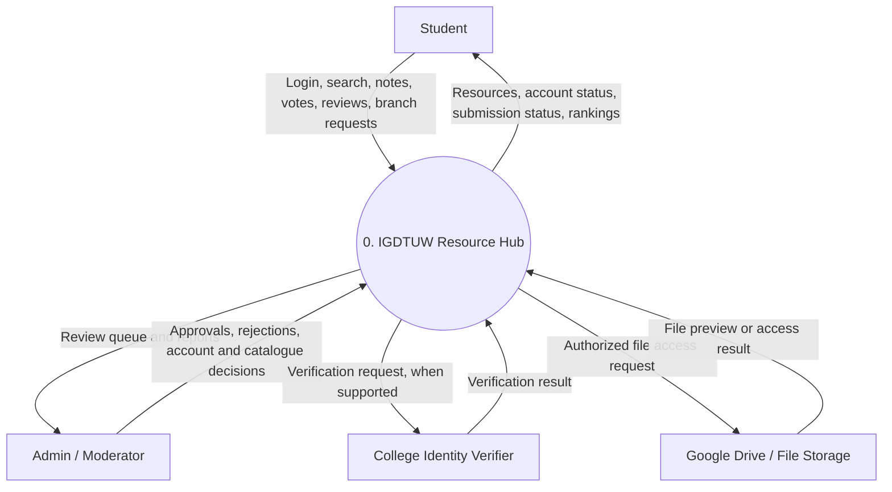
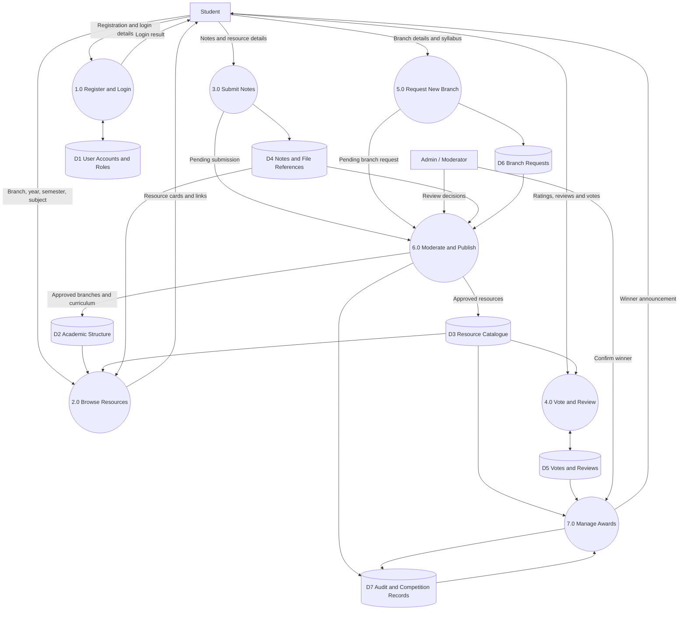
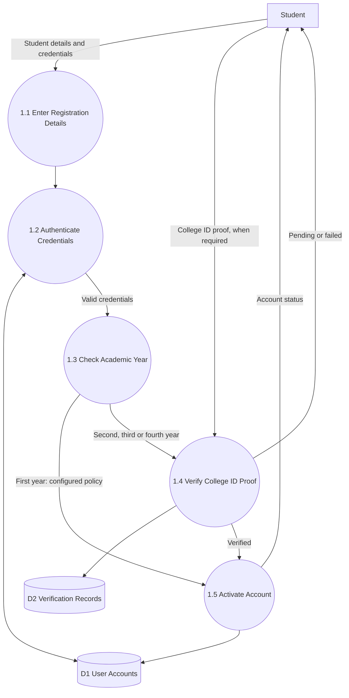
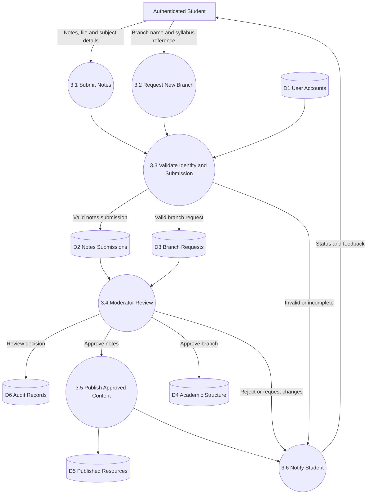

# 🎓 IGDTUW Resource Hub

**A student-driven academic resource-sharing platform for Indira Gandhi Delhi Technical University for Women (IGDTUW).**

IGDTUW Resource Hub aims to bring academic resources together in one organized place, making it easier for students to access notes, previous-year question papers (PYQs), lecture materials, books, lab files, and subject-wise study resources.

The platform will also encourage students to contribute their own notes, review and rate shared materials, suggest new branches, and recognize students who create high-quality academic resources.

> **Project status:** Planning and system design  
> Features described in this README are proposed features and may not yet be implemented.

---

## 📌 Table of Contents

- [Project Overview](#-project-overview)
- [Problem Statement](#-problem-statement)
- [Project Objectives](#-project-objectives)
- [Key Features](#-key-features)
- [Website Navigation and Workflow](#-website-navigation-and-workflow)
- [Student Authentication and Verification](#-student-authentication-and-verification)
- [Notes Contribution and Rewards](#-notes-contribution-and-rewards)
- [Branch Request System](#-branch-request-system)
- [System Architecture](#-system-architecture)
- [Data Flow Diagrams](#-data-flow-diagrams)
- [Database Design](#-database-design)
- [Security and Privacy](#-security-and-privacy)
- [Proposed Technology Stack](#-proposed-technology-stack)
- [Development Roadmap](#-development-roadmap)
- [Future Enhancements](#-future-enhancements)
- [Contributing](#-contributing)
- [License](#-license)

---

## 📖 Project Overview

IGDTUW Resource Hub is a centralized academic resource platform designed around the academic structure of the university.

Students can navigate through their branch, academic year, semester, and subject to find relevant study materials. Each subject will provide dedicated sections for Notes, PYQs, Lectures, Books, Lab Files, and Explore.

The platform will also include a community-driven section where students can upload and share their notes, receive feedback, discover popular resources, and participate in subject-wise recognition or rewards.

The project combines three major components:

1. **Academic Resource Library** — organized access to study materials.
2. **Student Contribution Community** — notes sharing, ratings, reviews, and voting.
3. **Content Management System** — student verification, branch requests, moderation, and resource approvals.

---

## ❗ Problem Statement

Students often find academic materials scattered across Google Drive folders, messaging groups, personal collections, and other platforms. This can make it difficult to identify the right resource for a particular subject or semester.

The proposed platform aims to address these challenges by providing:

- A structured and searchable academic resource library.
- Subject-wise organization of study materials.
- A central location for notes, PYQs, lectures, books, and lab files.
- A system for students to share better or alternative notes.
- Community feedback to help students discover useful resources.
- A controlled process for adding new branches and academic content.

---

## 🎯 Project Objectives

- Build an organized academic resource website for IGDTUW students.
- Provide intuitive navigation across branches, years, semesters, and subjects.
- Integrate resource links, including Google Drive-hosted documents.
- Enable authenticated students to submit notes and reviews.
- Introduce voting and popularity-based resource discovery.
- Allow students to request new branches and contribute syllabus information.
- Provide administrators with tools to verify submissions and manage content.
- Recognize valuable student contributions through a transparent reward system.

---

## ✨ Key Features

### 1. Academic Resource Library

- Multiple academic branches and programs.
- Four academic years, with two semesters per year.
- Subject-wise resource categories.
- Unit-wise notes and topic-wise materials.
- Practical-wise organization for lab resources.
- Links to PDFs, Google Drive documents, and other approved materials.

### 2. Student Accounts

- Student registration and login.
- A unique internal user ID for each account.
- Academic-year information and verification status.
- Ownership tracking for notes, reviews, and branch requests.
- Account roles for students, moderators, and administrators.

### 3. Explore Community

Each subject will have an **Explore** section that works as a community space for academic documents.

It will include:

- A prominent **“+ Add Your Notes & Win”** card.
- Previously submitted notes and documents.
- Note descriptions and contributor information.
- Reviews, ratings, and popularity scores.
- Options to discover useful resources and provide feedback.

### 4. Notes Submission and Review

- Submit notes associated with a specific subject.
- Add a title, description, and resource link or file.
- Track submission status.
- Review and rate published notes.
- Identify popular and highly rated resources.
- Maintain contributor attribution.

### 5. Add New Branch

Students can suggest an academic branch or program that is not yet available.

A branch request may include:

- Branch or program name.
- Syllabus document in PDF format.
- College ID proof, when required by the verification policy.
- Submission status and moderator feedback.

New branches will appear in the public catalogue only after approval.

### 6. Admin and Moderation Dashboard

- Review submitted notes.
- Review new branch requests.
- Manage resource publication.
- Handle reported or inappropriate content.
- Monitor ratings and suspicious voting.
- Manage account verification and roles.
- Record competition results and reward decisions.

---

## 🧭 Website Navigation and Workflow

The main website is planned around five navigation levels.

### Page 1 — Branch Selection

The home page will display available academic branches and programs, such as:

- CSE
- CSAI
- CSE AI-ML
- ECE-AI
- ECE
- Mechanical
- MCA
- BBA
- CSE-CS

The final list will be configurable and should reflect the university's actual programs.

An **Add New Branch** card will open the branch-request form.

### Page 2 — Academic Year and Semester

After selecting a branch, students will see four academic-year cards.

Each year will contain two semester buttons.

Example:

- First Year → Semester 1 and Semester 2
- Second Year → Semester 3 and Semester 4
- Third Year → Semester 5 and Semester 6
- Fourth Year → Semester 7 and Semester 8

The semester mapping should be configurable to accommodate different programs.

### Page 3 — Subject Selection

The selected semester will display subject cards.

Each subject will contain six resource categories:

| Category | Purpose |
|---|---|
| Notes | Subject notes and study material |
| PYQs | Previous-year question papers |
| Lectures | Lecture links and educational videos |
| Books | Recommended books and authorized materials |
| Lab Files | Practical files and lab-related resources |
| Explore | Student-contributed notes, ratings, reviews, and rankings |

### Page 4 — Resource Categories

The selected category will display the relevant resources.

Examples:

- Notes → Unit 1, Unit 2, Unit 3, Unit 4.
- PYQs → Available papers organized by year or examination.
- Lab Files → Practical 1 through Practical 10, where applicable.
- Lectures → Unit-wise or topic-wise lecture links.
- Books → Book references and authorized access links.

These categories will be configurable for individual subjects.

### Page 5 — Resource Viewer

The final page will open the selected resource.

Depending on the resource type, this may include:

- An embedded PDF viewer.
- A PDF or document link.
- A Google Drive link.
- An external lecture link.
- A downloadable file, where permitted.

**Important:** Google Drive permissions must be configured appropriately. The website should not expose private documents simply by displaying their links.

---

## 🔐 Student Authentication and Verification

The platform will associate contributions and activity with an authenticated student account rather than anonymous submissions.

### Proposed registration flow

1. The student creates an account.
2. The system authenticates the student.
3. The student provides the academic-year information required by the verification policy.
4. The platform determines whether college identity verification is required.
5. The account receives the appropriate verification status.
6. The student can access features permitted for that account.

### Proposed verification policy

- **First year:** College ID proof may be optional under the initial policy.
- **Second, third, and fourth years:** College ID proof is required before granting verified-student privileges.

The precise privileges available to unverified accounts should be defined before implementation.

Changing the academic year in a profile must not automatically bypass verification requirements.

### Authentication options

The implementation may use an established authentication provider or an officially supported university single sign-on system, if available.

The platform must not collect or store a student's existing university portal password as a substitute for official authentication.

---

## 📝 Notes Contribution and Rewards

The Explore section is designed to encourage students to share high-quality academic materials.

### Contribution workflow

1. A student opens a subject's Explore section.
2. The student selects **“+ Add Your Notes & Win.”**
3. The submission form collects the title, description, subject, and file or resource link.
4. The system records the contributor's internal user ID.
5. The submission enters the moderation queue.
6. An authorized moderator reviews the submission.
7. Approved notes are published in the subject's Explore section.
8. Students can review and rate the published material.
9. Eligible contributions may be considered for subject-wise recognition or rewards.

### Proposed reward system

The platform may organize subject-wise competitions to recognize useful student-created notes.

A proposed incentive is:

**“Submit your notes, help fellow students, and get a chance to win rewards worth ₹500 for the best notes.”**

This is a proposed reward, not a guaranteed payment or currently active competition.

The competition rules should define:

- Eligibility requirements.
- Submission deadlines.
- Judging criteria.
- How popularity and ratings affect the result.
- How duplicate or copied material is handled.
- How winners are selected and announced.
- Reward availability and fulfillment.

Ratings alone should not determine winners because popularity can be manipulated. Content quality, accuracy, originality, usefulness, and moderation should also be considered.

---

## 🏫 Branch Request System

The Add New Branch card will allow students to propose additional academic programs.

### Request workflow

1. The student opens the branch-request page.
2. The student enters the proposed branch or program name.
3. The student attaches a syllabus PDF or an approved document reference.
4. The system checks required fields and records the requester.
5. The request enters the moderation queue.
6. A moderator reviews the request and supporting documents.
7. The request is approved, rejected, or returned for changes.
8. If approved, the branch and its academic structure are added to the catalogue.
9. The requester receives a status update.

The system should prevent duplicate branch entries and keep a record of moderation decisions.

---

## 🏗️ System Architecture

The proposed system will contain the following layers:

```text
┌────────────────────────────────────────────┐
│              Student Interface             │
│ Branches → Years → Semesters → Subjects    │
│ Notes | PYQs | Lectures | Books | Lab Files │
│                    Explore                 │
└──────────────────────┬─────────────────────┘
                       │
                       ▼
┌────────────────────────────────────────────┐
│           Application / Backend            │
│ Authentication and Authorization           │
│ Resource Catalogue and Search               │
│ Notes Submission and Moderation             │
│ Ratings, Reviews and Voting                 │
│ Branch Requests and Rewards                 │
└───────────┬──────────────────┬─────────────┘
            │                  │
            ▼                  ▼
┌────────────────────┐  ┌────────────────────┐
│     Database       │  │ File / Link Storage│
│ Users and Roles    │  │ Google Drive       │
│ Academic Structure │  │ Approved PDFs      │
│ Resources          │  │ Other File Storage │
│ Reviews and Votes  │  └────────────────────┘
│ Submissions        │
└────────────────────┘

            ▲
            │
┌────────────────────────────────────────────┐
│       Protected Admin Dashboard            │
│ Verification | Approvals | Reports          │
│ Catalogue Management | Competition Results  │
└────────────────────────────────────────────┘
```

The database stores metadata, user records, resource references, and moderation history. The actual documents may be hosted in Google Drive or another appropriate file-storage service.

---

## 🔄 Data Flow Diagrams

The following DFDs describe the proposed information flow through the system.

### DFD Level 0 — Context Diagram

This diagram represents the entire platform as one process and shows its interactions with students, administrators, verification services, and file storage.



The identity verifier represents an external service only if an approved integration is available. Otherwise, authorized moderators may handle verification manually.

### DFD Level 1 — Major System Processes



**Main processes:**

- **1.0 Register and Login:** Authenticates users and checks their account status.
- **2.0 Browse Resources:** Retrieves the relevant academic resources.
- **3.0 Submit Notes:** Accepts student-created materials.
- **4.0 Vote and Review:** Manages feedback on published resources.
- **5.0 Request New Branch:** Records proposed academic programs.
- **6.0 Moderate and Publish:** Reviews submissions before publication.
- **7.0 Manage Awards:** Supports subject-wise competitions and recognition.

### DFD Level 2 — Registration and Login



The authentication system should use secure password hashing if passwords are managed by the application. College ID proof should be handled according to a clear verification, retention, and deletion policy.

### DFD Level 2 — Notes and Branch Requests



Only approved submissions should be published to the student-facing resource catalogue. Rejected or incomplete submissions should remain unpublished and provide an appropriate status or feedback message to the contributor.

---

## 🗄️ Database Design

The following entities are proposed for the initial database design.

| Entity | Purpose |
|---------------------------------------|----------------------------------------------------|
| Users | Stores internal user IDs, account information, academic year, and status |
| Roles | Defines student, moderator, and administrator permissions |
| Verification Records | Tracks verification status and necessary review metadata |
| Branches | Stores available academic branches and programs |
| Academic Years | Represents the academic years applicable to a program |
| Semesters | Stores semester information for each academic structure |
| Subjects | Stores subjects linked to branches and semesters |
| Resources | Stores published resource metadata and file references |
| Notes Submissions | Tracks student-submitted notes and their status |
| Votes and Reviews | Stores ratings, reviews, and voting records |
| Branch Requests | Tracks proposed branches and their review status |
| Competition Records | Tracks competition periods, judging, and results |
| Audit Records | Records important moderation and administrative actions |

### Important relationships

- One branch can have multiple semesters and subjects.
- One subject can contain multiple resources.
- One student can submit multiple notes and branch requests.
- A note can receive multiple reviews, subject to voting rules.
- A branch request may be approved or rejected by an authorized moderator.
- Competition results can reference eligible submissions and their contributors.

Use an internal user ID as the stable identifier across the database. Avoid exposing college identification numbers as public contributor IDs.

---

## 🛡️ Security and Privacy

Because the platform involves student accounts and college identity documents, security and data minimization are essential.

- Use an established authentication provider or supported university SSO when possible.
- Never store passwords in plain text.
- Enforce role-based authorization for administrative actions.
- Validate file types, sizes, and submitted links.
- Protect against unauthorized resource modifications and duplicate submissions.
- Rate-limit voting and review submissions.
- Keep college ID proof private and accessible only to authorized reviewers.
- Collect only the information necessary for verification.
- Define a retention period and secure deletion process for identity documents.
- Do not display private verification details in public profiles.
- Keep audit records for important administrative decisions.
- Respect copyright and permissions when uploading or linking books, notes, and other materials.

---

## 💻 Proposed Technology Stack

The final stack can be selected during implementation. One possible approach is:

| Layer | Proposed Technology |
|------------------------------------------------------------|------------------------------------------------------------|
| Frontend | HTML, CSS, JavaScript, or React |
| Backend | Node.js and Express.js |
| Database | PostgreSQL or MongoDB |
| Authentication | Secure session-based authentication or an established authentication provider |
| File Storage | Google Drive links or suitable object storage |
| Version Control | Git and GitHub |
| Deployment | A suitable frontend and backend hosting provider |

The database, authentication provider, and hosting environment should be finalized based on implementation requirements.

---

## 🛣️ Development Roadmap

### Phase 1 — Planning and Design

- [x] Define the main website navigation.
- [x] Identify student-facing features.
- [x] Draft DFD Level 0 and Level 1.
- [x] Draft DFD Level 2 for authentication and submissions.
- [ ] Finalize the database schema.
- [ ] Finalize the authentication and verification policy.
- [ ] Create wireframes for the main pages.

### Phase 2 — Core Resource Website

- [ ] Build the branch-selection page.
- [ ] Build academic-year and semester navigation.
- [ ] Build the subject-selection page with six categories.
- [ ] Build unit-wise and practical-wise resource pages.
- [ ] Integrate approved resource links and PDF viewing.

### Phase 3 — Accounts and Contributions

- [ ] Implement registration and login.
- [ ] Implement account verification and permissions.
- [ ] Build the Explore section.
- [ ] Implement notes submission.
- [ ] Implement resource reviews, ratings, and voting.

### Phase 4 — Branch Requests and Moderation

- [ ] Build the Add New Branch form.
- [ ] Implement syllabus document submission.
- [ ] Build the protected admin dashboard.
- [ ] Implement approval and rejection workflows.
- [ ] Add submission-status notifications.

### Phase 5 — Rewards and Deployment

- [ ] Implement subject-wise contribution rankings.
- [ ] Define transparent competition rules.
- [ ] Implement competition records and winner announcements.
- [ ] Test authorization, validation, and voting safeguards.
- [ ] Deploy the application.
- [ ] Document setup and usage instructions.

*The checkboxes indicate planning and progress tracking, not a claim that these features are already complete.*

---

## 🚀 Future Enhancements

Possible future additions include:

- Full-text search across subjects and resources.
- Personalized resource recommendations.
- Bookmarks and saved notes.
- Notifications when new materials are published.
- Contributor profiles and achievement badges.
- Improved filtering by subject, unit, academic year, and resource type.
- Duplicate-content detection.
- Resource version history.
- Mobile-friendly layouts.
- Analytics showing which resources students find useful.

---

## 🤝 Contributing

Contributions from students and developers can help improve the project.

Potential contributions include:

- Fixing bugs and improving accessibility.
- Improving the user interface.
- Adding verified resource metadata.
- Improving documentation.
- Suggesting new features.
- Reporting incorrect links or inappropriate content.

Before submitting code changes, contributors should:

1. Fork the repository.
2. Create a feature branch.
3. Make and test their changes.
4. Submit a pull request with a clear description.

Academic materials contributed to the live platform should follow the platform's verification and moderation rules.

---

## 📄 License

A license has not yet been selected. Choose an appropriate license before distributing the project publicly. Uploaded academic materials may have separate ownership and usage restrictions.

---

## 💡 Project Vision

**One university. One organized resource hub. A community that learns and grows together.**

IGDTUW Resource Hub aims to make academic resources easier to discover while empowering students to share knowledge, support their peers, and receive recognition for valuable contributions.
